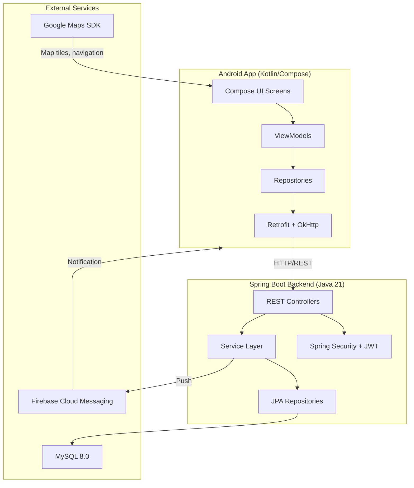
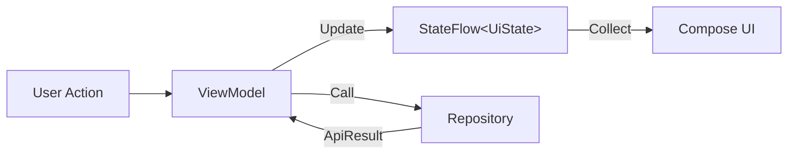
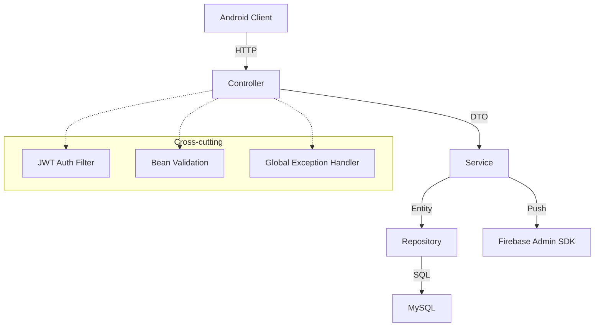
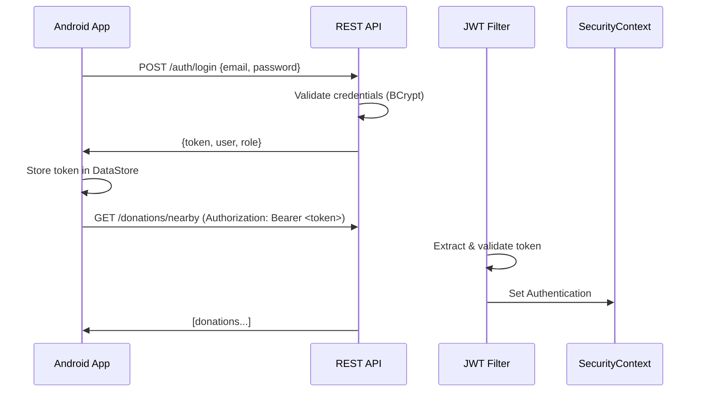
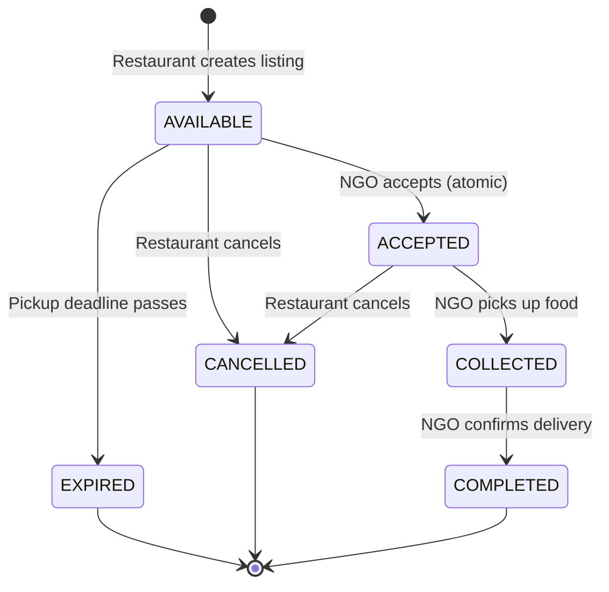
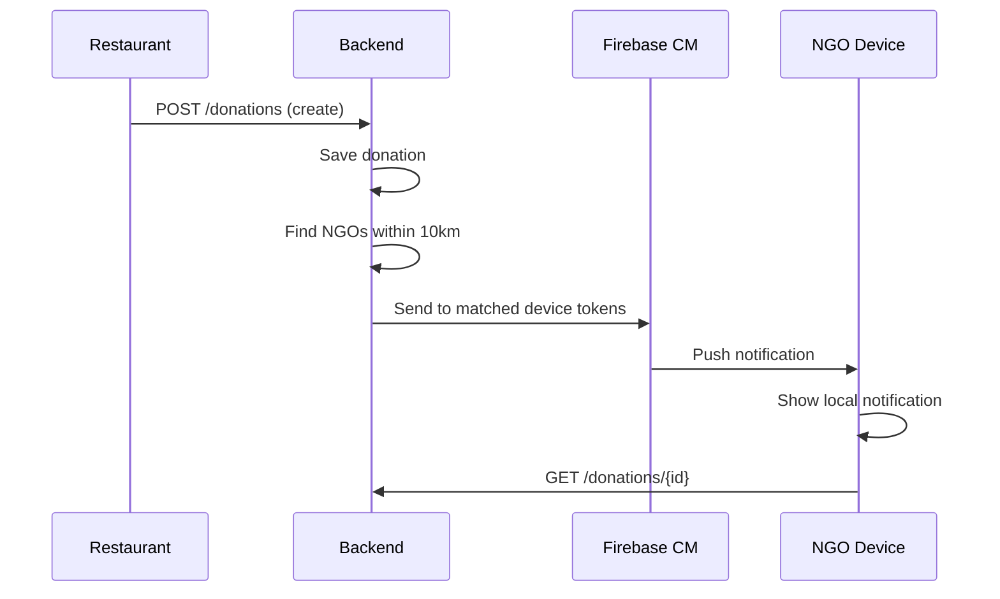

# FoodConnect Architecture

## System Overview

FoodConnect follows a client-server architecture with a native Android frontend communicating with a Spring Boot REST API backend backed by MySQL.



## Data Flow

```
Android UI → ViewModel → Repository → Retrofit → REST Controller → Service → JPA Repository → MySQL
```

Each layer has a clear responsibility:

| Layer | Responsibility |
|---|---|
| **Compose UI** | Render state, collect user input |
| **ViewModel** | Hold UI state, orchestrate use cases |
| **Repository** | Abstract network calls, map API responses to `ApiResult` |
| **Retrofit** | HTTP transport, JSON serialization |
| **Controller** | Request routing, input deserialization |
| **Service** | Business logic, authorization, validation |
| **JPA Repository** | Database queries, atomic updates |
| **MySQL** | Persistent storage |

## Android Architecture

### MVVM + Unidirectional Data Flow



### Package Structure

| Package | Contents |
|---|---|
| `app/` | `FoodConnectNavHost`, `SplashScreen`, routes |
| `core/network/` | `NetworkModule` (Hilt), `AuthInterceptor` |
| `core/security/` | `SessionManager` (DataStore) |
| `core/notifications/` | `FCMService` |
| `core/ui/theme/` | Material 3 theme, colors, typography |
| `data/model/` | DTOs matching backend |
| `data/remote/` | `FoodConnectApi` (Retrofit interface) |
| `data/repository/` | `AuthRepository`, `DonationRepository`, etc. |
| `feature/auth/` | Login, Register, Role Selection |
| `feature/restaurant/` | Dashboard, Create Donation |
| `feature/ngo/` | Dashboard (Nearby + Pickups tabs) |
| `feature/donations/` | Donation Detail |
| `feature/navigation/` | Pickup Navigation (Google Maps) |
| `feature/notifications/` | Notification List |

## Backend Architecture

### Layered Architecture



### Package Structure

| Package | Contents |
|---|---|
| `config/` | `SecurityConfig`, `AppConfig`, `OpenApiConfig` |
| `security/` | `JwtTokenProvider`, `JwtAuthenticationFilter`, `CustomUserDetails` |
| `controller/` | `AuthController`, `DonationController`, profile controllers |
| `service/` | `AuthService`, `DonationService`, `ProfileService`, `NotificationService` |
| `repository/` | JPA repositories with Haversine queries |
| `entity/` | JPA entities + `enums/` sub-package |
| `dto/` | Request/response DTOs with Bean Validation |
| `mapper/` | Entity ↔ DTO mapping components |
| `exception/` | Custom exceptions + `GlobalExceptionHandler` |

## Security Architecture



- **Password hashing:** BCrypt (Spring Security)
- **Token format:** JWT with user ID, email, role in claims
- **Token expiry:** 24 hours (configurable)
- **Authorization:** Role-based (`RESTAURANT`, `NGO`) enforced at service layer
- **Token transport:** `Authorization: Bearer <token>` header
- **Interceptor:** `AuthInterceptor` auto-attaches token from DataStore

## Donation State Machine



## Location & Discovery

- NGO location obtained via **Fused Location Provider**
- Nearby donations queried using **Haversine formula** (native SQL)
- Default search radius: **10 km** (configurable via `app.notification-radius-km`)
- Push notifications sent to NGOs within radius when a new donation is created

## Notification Flow


