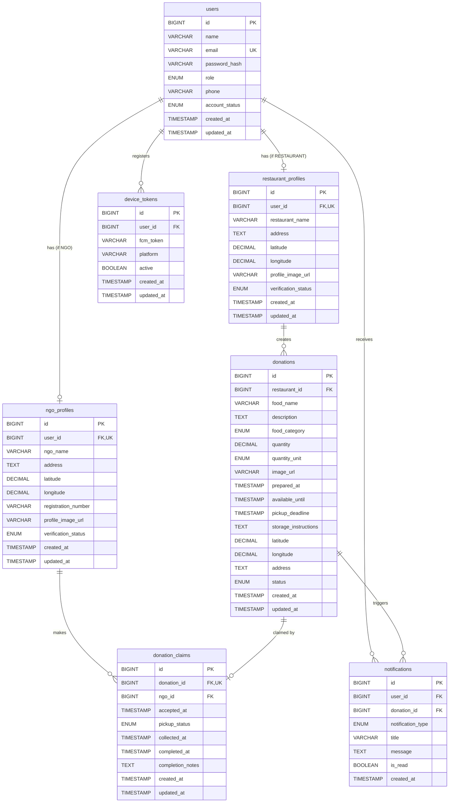

# FoodConnect Database Schema

## Overview

FoodConnect uses **MySQL 8.0** with schema managed by **Flyway** migrations (V1–V7). All tables use `BIGINT AUTO_INCREMENT` primary keys, `TIMESTAMP` columns for audit trails, and `ENUM` types for constrained values.

## Entity Relationship Diagram

## Tables

### `users` (V1)

| Column | Type | Constraints | Description |
|---|---|---|---|
| `id` | `BIGINT` | PK, AUTO_INCREMENT | |
| `name` | `VARCHAR(255)` | NOT NULL | Full name |
| `email` | `VARCHAR(255)` | NOT NULL, UNIQUE | Login identifier |
| `password_hash` | `VARCHAR(255)` | NOT NULL | BCrypt hash |
| `role` | `ENUM('RESTAURANT','NGO')` | NOT NULL | User type |
| `phone` | `VARCHAR(20)` | | Contact number |
| `account_status` | `ENUM('ACTIVE','INACTIVE','SUSPENDED')` | DEFAULT `'ACTIVE'` | |
| `created_at` | `TIMESTAMP` | DEFAULT `CURRENT_TIMESTAMP` | |
| `updated_at` | `TIMESTAMP` | ON UPDATE `CURRENT_TIMESTAMP` | |

**Indexes:** `idx_users_email` (email), `idx_users_role` (role)

### `restaurant_profiles` (V2)

| Column | Type | Constraints | Description |
|---|---|---|---|
| `id` | `BIGINT` | PK, AUTO_INCREMENT | |
| `user_id` | `BIGINT` | NOT NULL, UNIQUE, FK → `users(id)` | One profile per user |
| `restaurant_name` | `VARCHAR(255)` | NOT NULL | |
| `address` | `TEXT` | | Full address |
| `latitude` | `DECIMAL(10,8)` | | GPS coordinate |
| `longitude` | `DECIMAL(11,8)` | | GPS coordinate |
| `profile_image_url` | `VARCHAR(512)` | | |
| `verification_status` | `ENUM('PENDING','VERIFIED','REJECTED')` | DEFAULT `'PENDING'` | |
| `created_at` | `TIMESTAMP` | DEFAULT `CURRENT_TIMESTAMP` | |
| `updated_at` | `TIMESTAMP` | ON UPDATE `CURRENT_TIMESTAMP` | |

**Indexes:** `idx_restaurant_user_id` (user_id)

### `ngo_profiles` (V3)

| Column | Type | Constraints | Description |
|---|---|---|---|
| `id` | `BIGINT` | PK, AUTO_INCREMENT | |
| `user_id` | `BIGINT` | NOT NULL, UNIQUE, FK → `users(id)` | |
| `ngo_name` | `VARCHAR(255)` | NOT NULL | |
| `address` | `TEXT` | | |
| `latitude` | `DECIMAL(10,8)` | | |
| `longitude` | `DECIMAL(11,8)` | | |
| `registration_number` | `VARCHAR(255)` | | Gov registration ID |
| `profile_image_url` | `VARCHAR(512)` | | |
| `verification_status` | `ENUM('PENDING','VERIFIED','REJECTED')` | DEFAULT `'PENDING'` | |
| `created_at` | `TIMESTAMP` | DEFAULT `CURRENT_TIMESTAMP` | |
| `updated_at` | `TIMESTAMP` | ON UPDATE `CURRENT_TIMESTAMP` | |

**Indexes:** `idx_ngo_user_id` (user_id)

### `donations` (V4)

| Column | Type | Constraints | Description |
|---|---|---|---|
| `id` | `BIGINT` | PK, AUTO_INCREMENT | |
| `restaurant_id` | `BIGINT` | NOT NULL, FK → `restaurant_profiles(id)` | |
| `food_name` | `VARCHAR(255)` | NOT NULL | |
| `description` | `TEXT` | | |
| `food_category` | `ENUM(...)` | DEFAULT `'OTHER'` | See Food Categories |
| `quantity` | `DECIMAL(10,2)` | NOT NULL | |
| `quantity_unit` | `ENUM('KG','PORTIONS','PACKETS','LITERS','PIECES')` | NOT NULL | |
| `image_url` | `VARCHAR(512)` | | |
| `prepared_at` | `TIMESTAMP` | NULL | When food was prepared |
| `available_until` | `TIMESTAMP` | NOT NULL | |
| `pickup_deadline` | `TIMESTAMP` | NOT NULL | Auto-expiry trigger |
| `storage_instructions` | `TEXT` | | Handling notes |
| `latitude` | `DECIMAL(10,8)` | NOT NULL | Pickup location |
| `longitude` | `DECIMAL(11,8)` | NOT NULL | |
| `address` | `TEXT` | NOT NULL | |
| `status` | `ENUM(...)` | DEFAULT `'AVAILABLE'` | See Donation Statuses |
| `created_at` | `TIMESTAMP` | DEFAULT `CURRENT_TIMESTAMP` | |
| `updated_at` | `TIMESTAMP` | ON UPDATE `CURRENT_TIMESTAMP` | |

**Indexes:** `idx_donations_restaurant` (restaurant_id), `idx_donations_status` (status), `idx_donations_deadline` (pickup_deadline), `idx_donations_location` (latitude, longitude)

### `donation_claims` (V5)

| Column | Type | Constraints | Description |
|---|---|---|---|
| `id` | `BIGINT` | PK, AUTO_INCREMENT | |
| `donation_id` | `BIGINT` | NOT NULL, UNIQUE, FK → `donations(id)` | One claim per donation |
| `ngo_id` | `BIGINT` | NOT NULL, FK → `ngo_profiles(id)` | |
| `accepted_at` | `TIMESTAMP` | DEFAULT `CURRENT_TIMESTAMP` | |
| `pickup_status` | `ENUM('ASSIGNED','EN_ROUTE','ARRIVED','COLLECTED','COMPLETED')` | DEFAULT `'ASSIGNED'` | |
| `collected_at` | `TIMESTAMP` | NULL | |
| `completed_at` | `TIMESTAMP` | NULL | |
| `completion_notes` | `TEXT` | | |
| `created_at` | `TIMESTAMP` | DEFAULT `CURRENT_TIMESTAMP` | |
| `updated_at` | `TIMESTAMP` | ON UPDATE `CURRENT_TIMESTAMP` | |

**Indexes:** `idx_claims_donation` (donation_id), `idx_claims_ngo` (ngo_id)

### `device_tokens` (V6)

| Column | Type | Constraints | Description |
|---|---|---|---|
| `id` | `BIGINT` | PK, AUTO_INCREMENT | |
| `user_id` | `BIGINT` | NOT NULL, FK → `users(id)` | |
| `fcm_token` | `VARCHAR(512)` | NOT NULL | Firebase token |
| `platform` | `VARCHAR(20)` | DEFAULT `'ANDROID'` | |
| `active` | `BOOLEAN` | DEFAULT `TRUE` | |
| `created_at` | `TIMESTAMP` | DEFAULT `CURRENT_TIMESTAMP` | |
| `updated_at` | `TIMESTAMP` | ON UPDATE `CURRENT_TIMESTAMP` | |

**Unique constraint:** `uq_user_token` (user_id, fcm_token)  
**Indexes:** `idx_device_tokens_user` (user_id)

### `notifications` (V7)

| Column | Type | Constraints | Description |
|---|---|---|---|
| `id` | `BIGINT` | PK, AUTO_INCREMENT | |
| `user_id` | `BIGINT` | NOT NULL, FK → `users(id)` | |
| `donation_id` | `BIGINT` | NULL, FK → `donations(id)` | |
| `notification_type` | `ENUM(...)` | NOT NULL | See Notification Types |
| `title` | `VARCHAR(255)` | NOT NULL | |
| `message` | `TEXT` | | |
| `is_read` | `BOOLEAN` | DEFAULT `FALSE` | |
| `created_at` | `TIMESTAMP` | DEFAULT `CURRENT_TIMESTAMP` | |

**Indexes:** `idx_notifications_user` (user_id), `idx_notifications_read` (is_read), `idx_notifications_created` (created_at)

## Enums

### Roles
`RESTAURANT`, `NGO`

### Account Status
`ACTIVE`, `INACTIVE`, `SUSPENDED`

### Verification Status
`PENDING`, `VERIFIED`, `REJECTED`

### Donation Status
`AVAILABLE`, `ACCEPTED`, `COLLECTED`, `COMPLETED`, `EXPIRED`, `CANCELLED`

### Food Category
`COOKED_MEALS`, `RAW_INGREDIENTS`, `BAKERY`, `DAIRY`, `FRUITS_VEGETABLES`, `BEVERAGES`, `PACKAGED`, `OTHER`

### Quantity Unit
`KG`, `PORTIONS`, `PACKETS`, `LITERS`, `PIECES`

### Pickup Status
`ASSIGNED`, `EN_ROUTE`, `ARRIVED`, `COLLECTED`, `COMPLETED`

### Notification Type
`NEW_DONATION_NEARBY`, `DONATION_ACCEPTED`, `DONATION_COLLECTED`, `DONATION_COMPLETED`, `DONATION_CANCELLED`, `DONATION_EXPIRED`
